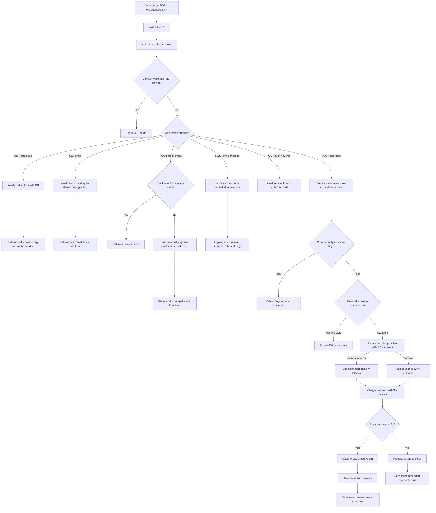

# Vastra API v1

A FastAPI strangle-service for the Vastra legacy estate. It provides versioned catalogue, pricing,
stock, checkout, override/audit and integration event APIs.

## Run locally

```powershell
cd FDE_Project_Codebase\vastra-modern-api
python -m venv .venv
.\.venv\Scripts\Activate.ps1
pip install -r requirements.txt

$env:VASTRA_LEGACY_DB = "..\vastra-legacy-lab\data\vastra_legacy.db"
$env:VASTRA_PARTNERS_URL = "http://localhost:8100"
python -m uvicorn app.main:app --port 8200
```

Open the browser test workbench at `http://localhost:8200/ui/`. It includes a read-only smoke
suite and manual controls for catalogue, pricing, stock events, price overrides, audit, outbox,
and checkout. Use `vastra-pos`, `vastra-warehouse`, or `vastra-erp` for endpoints that require
those roles. Stock events and overrides change the local API database; checkout reserves stock
and calls the payment partner, so use those controls only with local test services.

Bootstrap the legacy database and partner service first:

```powershell
cd ..\vastra-legacy-lab
python -m app.db
python -m uvicorn app.partners.stubs:app --port 8100
```

## API keys

The lab uses named API keys with endpoint roles:

| Key | Intended caller |
|---|---|
| `vastra-web` | Web |
| `vastra-app` | Mobile app |
| `vastra-pos` | Point of sale |
| `vastra-warehouse` | Warehouse |
| `vastra-erp` | ERP/WMS |

Production authentication must replace these demo keys with OAuth2/OIDC.

## Functional flow

The API authenticates each request using its API key and checks that key's role before running
the requested operation. Reads use the API-owned SQLite database, which can be initially seeded
from the legacy database in read-only mode. Stock and order changes are stored in the API database.



The outbox makes order and stock events available to ERP/WMS consumers through `GET /v1/events`.
Checkout is not a read-only operation: a successful checkout reduces stock and contacts the
configured payment partner.

## Example

```powershell
curl "http://localhost:8200/v1/prices/SKU00003?coupon_pct=10&member=true" `
  -H "X-API-Key: vastra-web"

curl -X POST "http://localhost:8200/v1/checkout" `
  -H "X-API-Key: vastra-web" `
  -H "Idempotency-Key: checkout-demo-001" `
  -H "content-type: application/json" `
  -d '{\"sku\":\"SKU00003\",\"qty\":1,\"coupon_pct\":10,\"member\":true}'
```
