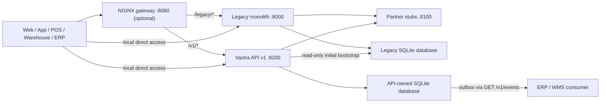

# Vastra API v1 — Modernised Legacy Estate

Vastra API v1 is a FastAPI service that incrementally modernises the synthetic Vastra ecommerce
legacy estate. It runs beside the 2014 monolith rather than replacing it. The API gives web, app,
POS, warehouse and ERP/WMS callers a shared interface for catalogue, pricing, stock, checkout,
auditing and integration events.

This repository is a local learning/demo implementation. It uses SQLite and demo API keys; the
production architecture described in the companion documents calls for PostgreSQL and
OAuth2/OIDC.

## What is included

| Component | Location | Purpose |
|---|---|---|
| Legacy monolith | `vastra-legacy-lab/app/monolith.py` | Original server-rendered product page, private app pricing endpoint and sequential checkout |
| Legacy test page | `vastra-legacy-lab/app/static/index.html` | Browser controls for the old product, mobile price and checkout routes |
| Partner stubs | `vastra-legacy-lab/app/partners/stubs.py` | Local courier and payment APIs used by both implementations |
| Modern API | `vastra-modern-api/app/main.py` | Versioned REST endpoints and business rules |
| Modern API database | `vastra-modern-api/app/db.py` | API-owned schema and optional read-only bootstrap from the legacy SQLite database |
| Modern API test page | `vastra-modern-api/app/static/index.html` | Read-only smoke checks and manual API requests |
| API tests | `vastra-modern-api/tests/test_api.py` | Authentication, pricing, stock, overrides and checkout checks |
| Legacy tests | `vastra-legacy-lab/tests/test_legacy_characterisation.py` | Tests describing legacy behavior and its known defects |
| Migration plan | `vastra-modern-api/MIGRATION.md` | Proposed 12-week incremental migration with rollback checkpoints |
| Legacy comparison | `vastra-modern-api/LEGACY-VS-MODERN.md` | Feature comparison and representative old/new code snippets |
| Demo client | `vastra-modern-api/demo.py` | Script that requests a quote and repeats checkout with the same idempotency key |

## Architecture



In the local setup the services can be called directly on ports 8000, 8100 and 8200. The optional
NGINX configuration is in `FDE_Project_Codebase/gateway/nginx.conf`; it routes `/legacy/*` and
`/v1/*` traffic to the corresponding services.

## Functional flow

Every modern request receives an `X-Request-ID` and `Server-Timing` response header. The API checks
the caller's demo API key and its role before running the endpoint. Catalogue and price requests
read API-owned product data. Stock events, overrides and checkout persist changes in the modern
database, and significant changes create outbox events for downstream consumers.

```mermaid
flowchart TD
    Caller["Channel client"] --> API["Vastra API v1"]
    API --> Context["Request ID and timing middleware"]
    Context --> Auth{"API key and role allowed?"}
    Auth -- No --> Deny["401 or 403"]
    Auth -- Yes --> Route{"Endpoint"}

    Route -- "GET catalogue" --> Catalogue["Read product"]
    Catalogue --> Cache["ETag and cache headers"]
    Route -- "GET prices" --> Pricing["Shared pricing rules"]
    Pricing --> Quote["Quote and calculation breakdown"]

    Route -- "POST stock event" --> Dedup{"Event ID already processed?"}
    Dedup -- Yes --> Duplicate["Return duplicate result"]
    Dedup -- No --> UpdateStock["Transactionally update stock and record movement"]
    UpdateStock --> StockEvent["Write stock.changed to outbox"]

    Route -- "POST override" --> Override["Validate store, reason and expiry"]
    Override --> Audit["Save override and audit entry"]
    Route -- "GET audit / events" --> ReadRecords["Return audit records or outbox events"]

    Route -- "POST checkout" --> Idempotency{"Completed order for this key?"}
    Idempotency -- Yes --> Original["Return saved response"]
    Idempotency -- No --> Reserve{"Reserve stock atomically"}
    Reserve -- "Insufficient" --> Conflict["409 out of stock"]
    Reserve -- Available --> Courier["Courier request, 0.8 s timeout"]
    Courier -- Timeout --> Fallback["Use estimated delivery fallback"]
    Courier -- Success --> Promise["Use courier promise"]
    Fallback --> Payment["Payment request, 3 s timeout"]
    Promise --> Payment
    Payment --> Paid{"Payment success?"}
    Paid -- Yes --> Capture["Capture reservation"]
    Capture --> SaveOrder["Save order and payment"]
    SaveOrder --> OrderEvent["Write order.created to outbox"]
    Paid -- No --> Release["Release reserved stock"]
    Release --> SaveFailure["Save failed payment result"]
```



## Functional areas

### Catalogue

`GET /v1/catalogue/{sku}` reads the product and returns an `ETag` and `Cache-Control` header.
Unknown SKUs return 404.

### Centralised pricing

`GET /v1/prices/{sku}` applies one policy to all callers:

1. Start with the base price.
2. Apply an active sale price using its UTC end time.
3. Apply the coupon percentage.
4. Apply the member discount.
5. Apply an active store-specific override when `store_id` is provided.

The response includes the unit price, quantity, total, currency, policy version and price
breakdown. The order of operations is the API's current lab policy and should be confirmed by
pricing stakeholders before production use.

### Stock ledger

`POST /v1/stock/events` accepts an `event_id`, SKU, quantity delta and reason. Repeated event IDs
are ignored; an update that would make stock negative returns 409. Stock and the corresponding
outbox event are committed together.

### Checkout

`POST /v1/checkout` requires an `Idempotency-Key`. It checks for a completed order with that key,
reserves live API-ledger stock, requests a courier promise, and then requests payment. If payment
fails, it releases the stock reservation. Successful orders create an `order.created` outbox
event.

Checkout is state-changing and calls the payment partner. Only exercise it against local test
services. Courier and payment calls are time-bounded, but currently happen sequentially.

### Price overrides and audit

`POST /v1/overrides` creates a store-scoped override with a reason and future expiry, and writes an
audit record containing the actor and request ID. `GET /v1/audit/overrides` reads those records.
The endpoint takes the acting user from the `X-User` header; this is demo identity, not proof of
authentication in production.

### Outbox

Stock changes and successful orders create events in the `outbox` table. `GET /v1/events` exposes
them for ERP/WMS consumers. This lab exposes a pull endpoint; it does not yet include a background
publisher or a message broker.

## Local setup

The following commands are for Windows PowerShell. Run each service in its own terminal, starting
from the repository root.

### 1. Create a shared development environment

```powershell
python -m venv .venv
.\.venv\Scripts\Activate.ps1
python -m pip install -r FDE_Project_Codebase\vastra-modern-api\requirements.txt
```

The modern requirements include the shared FastAPI, Uvicorn, HTTPX and pytest dependencies used
for this local lab.

### 2. Create and seed the legacy database

Run once from the legacy lab directory:

```powershell
cd FDE_Project_Codebase\vastra-legacy-lab
..\..\.venv\Scripts\python.exe -m app.db
```

This writes `data/vastra_legacy.db`. Seeding re-creates the legacy tables and sample products; do
not run it against a database whose contents you need to preserve.

### 3. Start the partner stubs

In a new terminal from the legacy lab directory:

```powershell
cd FDE_Project_Codebase\vastra-legacy-lab
$env:LATENCY_SCALE = "0.01"
$env:PAYMENT_FAIL_RATE = "0"
..\..\.venv\Scripts\python.exe -m uvicorn app.partners.stubs:app --host 127.0.0.1 --port 8100
```

The lower latency and zero failure rate are convenient for a local demonstration; remove or
adjust these variables to exercise slower or failing partner responses.

### 4. Start the legacy monolith (optional)

In another terminal:

```powershell
cd FDE_Project_Codebase\vastra-legacy-lab
..\..\.venv\Scripts\python.exe -m uvicorn app.monolith:app --host 127.0.0.1 --port 8000
```

Legacy pages:

- Test page: `http://127.0.0.1:8000/test-ui/`
- Service endpoint list: `http://127.0.0.1:8000/`
- OpenAPI docs: `http://127.0.0.1:8000/docs`

### 5. Start the modern API

In a separate terminal:

```powershell
cd FDE_Project_Codebase\vastra-modern-api
$env:VASTRA_LEGACY_DB = "..\vastra-legacy-lab\data\vastra_legacy.db"
$env:VASTRA_PARTNERS_URL = "http://127.0.0.1:8100"
..\..\.venv\Scripts\python.exe -m uvicorn app.main:app --host 127.0.0.1 --port 8200
```

Modern pages:

- API test workbench: `http://127.0.0.1:8200/ui/`
- OpenAPI docs: `http://127.0.0.1:8200/docs`
- Health: `http://127.0.0.1:8200/v1/health`

If `VASTRA_LEGACY_DB` is set, startup copies products and initial `stock_copy` quantities into the
API database using a read-only connection to the legacy database. Existing API rows are preserved
by `INSERT OR IGNORE`; re-seeding the legacy database will not automatically refresh API data.

## API reference

All modern endpoints are under `/v1`. Except for health, requests require `X-API-Key`.

| Method and path | Role | Purpose |
|---|---|---|
| `GET /v1/health` | None | Health/status check |
| `GET /v1/catalogue/{sku}` | `catalogue:read` | Product read with cache headers |
| `GET /v1/prices/{sku}` | `price:read` | Price quote |
| `POST /v1/stock/events` | `stock:write` | Apply an idempotent stock movement |
| `POST /v1/overrides` | `override:write` | Create an audited store price override |
| `GET /v1/audit/overrides` | `audit:read` | Read override audit history |
| `GET /v1/events` | `events:read` | Read outbox events |
| `POST /v1/checkout` | `checkout:create` | Reserve stock and place a checkout |

Demo API keys and their role grants:

| Key | Roles |
|---|---|
| `vastra-web` | Catalogue read, price read, checkout create |
| `vastra-app` | Catalogue read, price read, checkout create |
| `vastra-pos` | Catalogue read, price read, stock write, override write, audit read, checkout create |
| `vastra-warehouse` | Stock write |
| `vastra-erp` | Events read |

These are hard-coded, publicly known demo values in `app/main.py`; they are not production
credentials and should not be exposed outside a trusted local environment.

## Examples

### Read product and quote

```powershell
curl "http://127.0.0.1:8200/v1/catalogue/SKU00003" `
  -H "X-API-Key: vastra-web"

curl "http://127.0.0.1:8200/v1/prices/SKU00003?coupon_pct=10&member=true&qty=2" `
  -H "X-API-Key: vastra-web"
```

### Post a stock movement

```powershell
curl -X POST "http://127.0.0.1:8200/v1/stock/events" `
  -H "X-API-Key: vastra-warehouse" `
  -H "X-User: warehouse-operator" `
  -H "content-type: application/json" `
  -d '{\"event_id\":\"delivery-001\",\"sku\":\"SKU00003\",\"delta\":5,\"reason\":\"warehouse.received\"}'
```

### Create an audited override

```powershell
curl -X POST "http://127.0.0.1:8200/v1/overrides" `
  -H "X-API-Key: vastra-pos" `
  -H "X-User: manager-07" `
  -H "content-type: application/json" `
  -d '{\"sku\":\"SKU00003\",\"store_id\":\"ST001\",\"price\":999,\"reason\":\"Local promotion\",\"expires_at\":\"2099-12-31T23:59:59+00:00\"}'
```

### Place checkout

```powershell
curl -X POST "http://127.0.0.1:8200/v1/checkout" `
  -H "X-API-Key: vastra-web" `
  -H "Idempotency-Key: checkout-demo-001" `
  -H "content-type: application/json" `
  -d '{\"sku\":\"SKU00003\",\"qty\":1,\"coupon_pct\":10,\"member\":true,\"pincode\":\"560001\"}'
```

## Tests and demo

Run the API test suite:

```powershell
cd FDE_Project_Codebase\vastra-modern-api
..\..\.venv\Scripts\python.exe -m pytest -q tests\test_api.py
```

Run the legacy characterization and UI tests:

```powershell
cd FDE_Project_Codebase\vastra-legacy-lab
..\..\.venv\Scripts\python.exe -m pytest -q tests\test_legacy_characterisation.py
```

The browser pages are useful for manual comparison:

- Legacy test UI: `http://127.0.0.1:8000/test-ui/`
- Modern API workbench: `http://127.0.0.1:8200/ui/`

The modern UI smoke suite checks health, catalogue and pricing without writes. Stock events and
overrides modify the API database. Checkout reduces ledger stock and calls payment. The legacy
checkout can charge on repeated requests because it does not implement idempotency; its UI asks
for confirmation before sending the request.

The demonstration client can be run with:

```powershell
cd FDE_Project_Codebase\vastra-modern-api
..\..\.venv\Scripts\python.exe demo.py
```

It uses a fixed demonstration idempotency key. The first call may create an order; subsequent
calls using the same key return the previously completed order.

## Current limitations and production follow-up

- **Authentication:** API keys and `X-User` are demo-only; use managed secrets and OAuth2/OIDC.
- **Database:** SQLite is for the local lab; production reservations require PostgreSQL and tested
  transaction/locking behavior.
- **Checkout recovery:** Idempotency stores completed responses only. It does not persist an
  in-progress state or recover safely from a process failure after external payment but before
  recording the order.
- **Payment provider:** The idempotency key is forwarded, but the included payment stub ignores
  it. End-to-end duplicate-charge safety requires provider support and reconciliation.
- **Partner order:** Courier and payment calls are sequential, not parallel. Each has a timeout,
  but the overall endpoint duration is the combined duration.
- **Outbox delivery:** Events can be pulled from the endpoint; no queue publisher, consumer
  acknowledgement, or published-state workflow is included.
- **Stock ownership:** The legacy bootstrap is an initial copy, not continuous legacy-to-modern
  replication. Production cutover needs reconciliation and a defined single-writer point.
- **Pricing policy:** The order of coupon and member discounts is a demo policy and requires
  business approval.
- **Gateway:** The NGINX configuration is present as a routing example and is not required for
  direct local testing.

## Related documents

- [Legacy vs Modern API](./LEGACY-VS-MODERN.md) — quick comparison and code snippets.
- [Migration plan](./MIGRATION.md) — proposed rollout and rollback stages.
- [Session handoff](./SESSION-HANDOFF.md) — current implementation state and continuation checklist.
